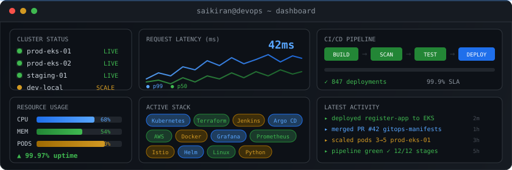

<div align="center">

<!-- Animated Header -->


<!-- Custom Animated Dashboard -->


</div>

<br>

<div align="center">

[](https://www.linkedin.com/in/d-saikiran-reddy/)
[](https://github.com/Saikiran5604)


</div>

---

### `> whoami`

I build the infrastructure that lets teams ship without thinking about infrastructure.  
Kubernetes clusters, CI/CD pipelines, monitoring stacks, GitOps workflows — I design them, automate them, and keep them running at scale.

If it's not in Git, it doesn't exist. If it's not monitored, it's not in production.

---

### `> kubectl get skills`

<div align="center">


</div>

<table>
<tr>
<td width="50%">

**Orchestration & Cloud**
```
Kubernetes (EKS)  ████████████████████  Expert
Helm / Istio      ████████████████░░░░  Advanced
Terraform / IaC   ████████████████████  Expert
AWS Cloud         ████████████████░░░░  Advanced
```

</td>
<td width="50%">

**CI/CD & Observability**
```
Jenkins Pipelines  ████████████████████  Expert
Argo CD / GitOps   ████████████████████  Expert
Grafana+Prom       ████████████████░░░░  Advanced
Trivy / SonarQube  ███████████████░░░░░  Advanced
```

</td>
</tr>
</table>

---

### `> ls projects/`

<table>
<tr>
<td align="center" width="50%">
<h4>⎈ <a href="https://github.com/Saikiran5604/register-app">register-app</a></h4>
<p><sub>End-to-end CI/CD: Jenkins → SonarQube → Docker → Trivy → Argo CD → AWS EKS</sub></p>
  
</td>
<td align="center" width="50%">
<h4>☁️ <a href="https://github.com/Saikiran5604/cloud-native-platform">cloud-native-platform</a></h4>
<p><sub>Multi-cloud K8s with Kyverno policies, Istio mesh, and platform engineering</sub></p>
  
</td>
</tr>
<tr>
<td align="center" width="50%">
<h4>🔄 <a href="https://github.com/Saikiran5604/gitops-register-app">gitops-register-app</a></h4>
<p><sub>GitOps manifests synced by Argo CD — push YAML, cluster converges</sub></p>
  
</td>
<td align="center" width="50%">
<h4>🤖 <a href="https://github.com/Saikiran5604/JARVIS">JARVIS</a></h4>
<p><sub>Autonomous workspace agent — automates the things I got tired of doing twice</sub></p>
  
</td>
</tr>
<tr>
<td align="center" width="50%">
<h4>📦 <a href="https://github.com/Saikiran5604/wisecow-deployment">wisecow-deployment</a></h4>
<p><sub>Containerized app with full CI/CD pipeline and K8s orchestration</sub></p>
  
</td>
<td align="center" width="50%">
<h4>💳 <a href="https://github.com/Saikiran5604/stripe-lite-system">stripe-lite-system</a></h4>
<p><sub>Billing platform: JWT auth, RBAC, Row Level Security, deployed on Vercel</sub></p>
  
</td>
</tr>
</table>

---

### `> cat /etc/hobbies.conf`

```nginx
# what keeps the system (me) from overheating

upstream wellness {
    server  morning-run:10k     weight=5;   # 6:30 AM, rain or shine
    server  movie-night:friday  weight=3;   # sci-fi & thrillers
    server  homelab:always      weight=4;   # linux, dotfiles, the never-ending side quest
    server  learning:sunday     weight=2;   # currently: Azure, SRE, Gradle
}
```

🏃 **Runner** — 10k mornings before the first `kubectl`  
🎬 **Movie buff** — if it's sci-fi or a thriller, I've probably seen it  
🐧 **Linux tinkerer** — dotfiles are never finished, and that's the point  

---

### `> grafana dashboard`

<div align="center">


</div>

<div align="center">


</div>

<br>

<div align="center">
  <picture>
    <source media="(prefers-color-scheme: dark)" srcset="https://raw.githubusercontent.com/Saikiran5604/Saikiran5604/output/github-snake-dark.svg" />
    <source media="(prefers-color-scheme: light)" srcset="https://raw.githubusercontent.com/Saikiran5604/Saikiran5604/output/github-snake.svg" />
    
  </picture>
</div>

---

<div align="center">


</div>

---

<div align="center">

</div>
